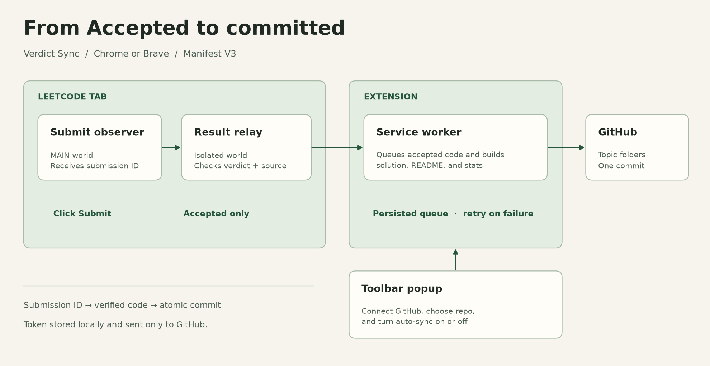

# Verdict Sync

Verdict Sync saves your **accepted LeetCode submissions** to a GitHub repository you choose. The Chrome and Brave toolbar popup shows your destination, sync switch, and latest activity.

## How to set up

### Download and install the extension

1. [Download Verdict Sync as a ZIP](https://github.com/gliminmorais/Leetcode-submission-sync/archive/refs/heads/main.zip) and extract it. You can also choose **Code → Download ZIP** on this repository's GitHub page.
2. Open `chrome://extensions` in Chrome or `brave://extensions` in Brave and turn on **Developer mode**.
3. Click **Load unpacked** and select the extracted **`extension/`** folder that contains `manifest.json`. Pin **Verdict Sync** from the browser's Extensions menu for easy access.

### Connect GitHub

1. Pick the GitHub repository where you want to save your solutions, such as `Leetcode-submissions`. If you create a new one, initialize it with a README so it has a default branch.
2. [Create a fine-grained personal access token](https://github.com/settings/personal-access-tokens/new). Select the repository's owner, grant access to that repository only, and set **Repository permissions → Contents** to **Read and write**.
3. Open **Verdict Sync**, enter your solutions repository URL and paste the token into the popup. Click **Connect GitHub**. Confirm that the destination is correct and **Auto-sync** is on.

### Connect LeetCode

1. Sign in to [LeetCode](https://leetcode.com/) in the same Chrome or Brave profile where you installed Verdict Sync. The extension uses that session.
2. Refresh any LeetCode tabs that were already open. On a problem page, click **Submit** and keep the tab open until the extension reads the result.
3. When LeetCode marks your submission **Accepted**, open Verdict Sync and select **View commit** to see the uploaded files in GitHub.

To recover a missed upload, open the accepted attempt from LeetCode's **Submissions** list, open Verdict Sync, and select **Sync open submission**. The extension checks the saved result and skips submission IDs that are already in the repository.

To update an unpacked installation, replace the contents of the same `extension/` folder, click **Reload** on the browser's Extensions page, and refresh your LeetCode tabs. Using the same folder keeps your connection settings.

## What gets committed

```text
Leetcode-submissions/
├── README.md
├── STATS.md
├── .verdict-sync/
│   └── index.json
└── array/
    └── easy/
        └── 0001-two-sum/
            ├── README.md
            ├── python3-1923456789.py
            └── typescript-1923456790.ts
```

The first LeetCode topic determines the folder, and the problem stays there on later syncs. Problems without a topic go under `uncategorized/`. The generated problem README lists all topics, the difficulty, and a link to LeetCode. Each accepted attempt gets its own source file.

**`STATS.md`** updates in the same commit with unique problems solved, accepted submissions, breakdowns by topic, difficulty, and language, and recent activity with runtime and memory when available. The generated index remembers submission IDs and folder paths. Topic totals include every tag on a problem.

## Architecture



| Component | Responsibility |
| --- | --- |
| [Submit observer](extension/observer.js) | Captures the submission ID from a successful **Submit** response and keeps the matching request source as a fallback. **Run** does not start a sync. |
| [Result relay](extension/relay.js) | Checks that LeetCode returned **Accepted** for that ID and reads the saved source. If saved details are unavailable after a new Submit, it checks the signed-in user's submission history before using the exact request source. |
| [Service worker](extension/worker.js) | Saves validated submissions in a local queue and retries temporary failures. |
| [GitHub client](extension/github.js) and [stats generator](extension/stats.js) | Read the current index, deduplicate submissions, and commit the source, problem README, stats, and index together. Concurrent branch changes trigger a retry against the new head. |
| [Toolbar popup](extension/popup.html) | Sets the destination and auto-sync state and shows the latest activity. |

There is no backend. The token and pending queue are stored in your browser profile. The token is sent only to GitHub's API. Verdict Sync uses your existing LeetCode session and tracks new submissions on `leetcode.com`.

## Troubleshooting

| If you see | Try |
| --- | --- |
| **Connect fails** | Confirm the repository has an initial commit, the token includes that exact repository, and **Contents** is **Read and write**. An organization may require token approval. |
| **Accepted but nothing synced** | Check the auto-sync switch and the repository shown. Refresh old tabs after loading or updating the extension. Keep the LeetCode tab open until it finishes reading the result. |
| **A submission is waiting** | Temporary GitHub errors retry automatically while sync is on. Use **Retry sync** once the issue is fixed. If your token expired, use **Update token**. |
| **GitHub blocks the branch update** | The selected repository's default branch must permit direct commits from your account. Use a dedicated solutions repository if your main repo requires pull requests. |

Turning auto-sync off holds queued uploads and skips new captures. Disconnecting clears the token and prompts before discarding queued uploads. Changes to LeetCode's website may require an extension update.

## Develop and verify

Run `npm test` with Node.js 20 or newer. To regenerate the architecture image and icons, install Matplotlib and run `python tools/draw_architecture.py`.
